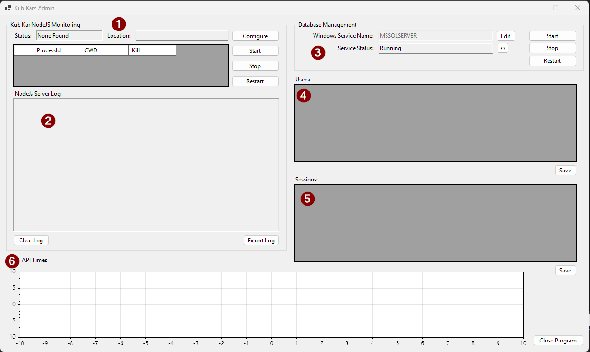
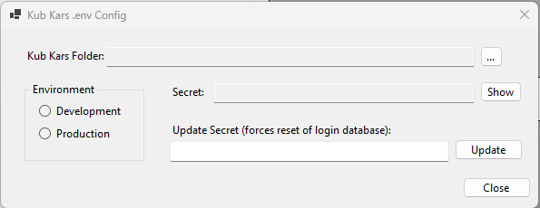
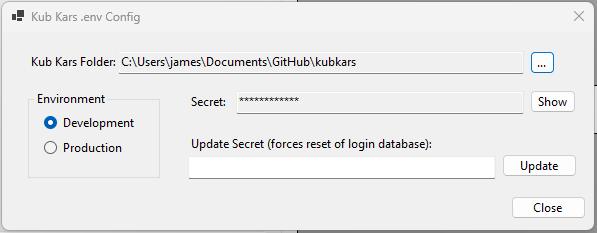
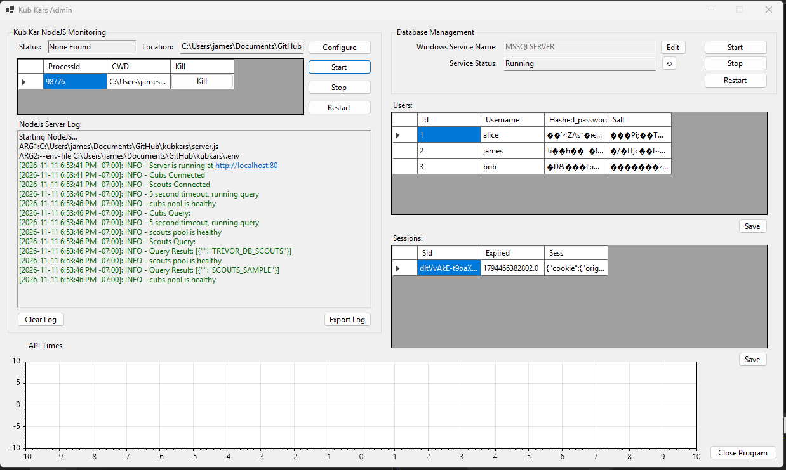
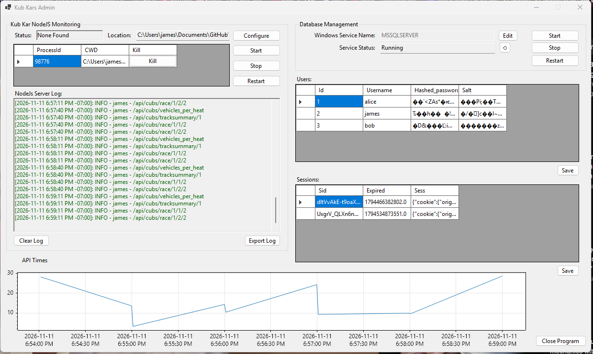

# KubKarsServerAdmin

KubKarsServerAdmin is an administration program for the [kubkars](https://github.com/JamesProfitt/kubkars) application.

## Features

- Start/Stop the NodeJS Server.
- Configure the environment variables used by KubKars.
- Start/Stop the SQL Server.
- Captures the JSON log output and:
-- Colour codes log messages for easy reading.
-- Processes performance metrics and plots the average response time of all routes
- View the logged in Users
- View the existing Sessions
- Can highlight and delete a user entry, and ask a user to re-signup if there's a problem.
- Can highlight and delete a session entry, and ask a user to re-sign-in if there's a problem.

## Notes

- The application auto-elevates because Windows requires elevated privileges when starting and stopping services.

## How to Use / Screenshots

The application starts with a blank set of controls, and requires user input to begin. The numbers refer as follows:

1. NodeJS Monitoring
  1. The Status and Location fields are updated after the user presses "Configure", and selects a location.
  2. The Start/Stop/Restart buttons control the NodeJS server once a location is selected.
  3. The Data Grid will update with the Process ID, and Working Directory, and a button for terminating the process in question.
2. The Server Log will update once the NodeJS server is started, and will automatically scroll to the bottom.
3. The Database Management section will allow a user to start/stop the Microsoft SQL Server process. The Service Name can be edited as required.
4. The Users grid will update once the location of the NodeJS Server is selected.
5. The Sessions grid will update once the location of the NodeJS Server is selected.
6. The API Times grid will automatically update when the NodeJS Server is started, and the routes start being used.

The Config Screen will appear when the user presses "Configure".

Once the location is selected, the secret and environment variables can be updated. The user may then simply close the dialog to save.

The Users and Sessions grid is updated automatically:

Once the server starts running, the log messages are parsed and displayed:

The graph will update once the data starts flowing in:

## Build from Source

You can build from source by cloning the repo, opening the project in Visual Studio, and pressing "Build".

## Contributing

Please!

## License

The Unlicense

See the License.txt file for details.

